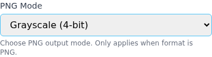

# Screenshot Home Assistant using Puppeteer

Easily create screenshots of your Home Assistant dashboards. Allowing you to put them on e-ink screens or any other screen that can display images.

[](https://my.home-assistant.io/redirect/supervisor_addon/?addon=0f1cc410_puppet&repository_url=https%3A%2F%2Fgithub.com%2Fballoob%2Fhome-assistant-addons)


You will need to create a long lived access token and add it as an add-on option.

Enable the watch dog option to restart the add-on when the browser fails to launch (happens sometimes, still investigating).

_This is a prototype, there is NO security. Anyone can access the server and make screenshots of any Home Assistant page._

[](./example/)

## Configuration

- access_token: Long-lived access token used to authenticate against Home Assistant.

## Advanced configuration

- home_assistant_url: Base URL of your Home Assistant instance that the add-on browser should open when taking screenshots. Defaults to `http://homeassistant:8123` which is the internal URL at which the add-on can reach Home Assistant. You can override it if your instance has configured SSL certificates inside Home Assistant and requires to be reached via a different hostname or port (e.g., http://my-ha.local:8123 or https://example.duckdns.org).
- keep_browser_open: If true, keeps the Chromium browser alive between requests.
- push_screenshot_url: A relative screenshot URL that enables push mode. Requires `keep_browser_open: true`.
- push_screenshot_name: The name used in the push-mode image URL. Defaults to `dashboard`.

## Web UI

The add-on now includes a web-based user interface to help you easily configure and preview screenshots. You can access it by:

1. Opening the add-on's Web UI from the Home Assistant Supervisor interface
2. Or navigating directly to `http://homeassistant.local:10000/`

The Web UI provides:
- Interactive form to configure screenshot parameters (path, viewport size, format, theme, etc.)
- Live preview of screenshots
- Automatically generated URL that you can copy and use in your automations or external applications

This is particularly useful for testing different settings and finding the perfect configuration before using the URLs in your automations.

## Usage

Starting the add-on will launch a new server on port 10000. Any path you request will return a screenshot of that page. You will need to specify the viewport size you want.

For example, to get a 1000px x 1000px screenshot of your default dashboard, fetch:

```
http://homeassistant.local:10000/home?viewport=1000x1000
```

### e-ink displays

To reduce the color palette for e-ink displays, you can add the `colors` parameter. The value is a comma-separated list of hex colors to use. For example, for a 2-color e-ink display (black and white):

```
http://homeassistant.local:10000/home?viewport=1000x1000&colors=000000,FFFFFF
```

You can also invert the colors by adding the `invert` parameter:

```
http://homeassistant.local:10000/home?viewport=1000x1000&colors=000000,FFFFFF&invert
```

It's recommended to use an e-ink theme like [Graphite](https://github.com/TilmanGriesel/graphite?tab=readme-ov-file#e-ink-themes) to optimize readability.

### Set Theme

You can set the theme of the Home Assistant interface for the screenshot by adding the `theme` query parameter. The value should be a theme name that Home Assistant supports (e.g., `Graphite E-ink Light`).

```
http://homeassistant.local:10000/home?viewport=1000x1000&theme=Graphite%20E-ink%20Light
```

**Note:** Theme changes apply to all sessions of the user whose token is used. To avoid having your normal browsing sessions affected by screenshot themes (e.g., e-ink themes), create a separate user account specifically for Puppet and use that user's long-lived access token in the addon configuration.

### Finish loading detection

By default, on a cold start the server will wait for 2.5 extra seconds after the loading is considered done, to give things that are not tracked by loading spinners to load (ie icons, pictures). When the browser is active, it waits 750ms. You can control this wait time by adding a `wait` query parameter. For example, to wait 10 seconds:

```
http://homeassistant.local:10000/home?viewport=1000x1000&wait=10000
```

You can control the zoom level of the page using the `zoom` query parameter. The default zoom level is 1. For example, to zoom in 1.3x:

```
http://homeassistant.local:10000/home?viewport=1000x1000&zoom=1.3
```

### Full page

By default the screenshot is clipped to the viewport height. Set the height to `auto` in the `viewport` parameter to capture the entire scrollable page instead, so a dashboard that extends below the fold is captured in one shot. The width still applies; the height grows to fit the content, capped at 4000px so a very long page can't produce a runaway image.

```
http://homeassistant.local:10000/home?viewport=1000xauto
```

### Output formats

By default, the output format is PNG. You can request a JPEG, WebP or BMP image by adding the `format=jpeg`, `format=webp`, `format=bmp` query parameter:

```
http://homeassistant.local:10000/home?viewport=1000x1000&format=jpeg
```

```
http://homeassistant.local:10000/home?viewport=1000x1000&format=webp
```

```
http://homeassistant.local:10000/home?viewport=1000x1000&format=bmp
```

For a smaller grayscale image, select **PNG** as the format and
**Grayscale (4-bit)** under **PNG Mode**, or use `png_mode=grayscale`:

```
http://homeassistant.local:10000/home?viewport=1200x825&png_mode=grayscale
```



This converts the screenshot to a true 4-bit grayscale PNG without transparency,
using sixteen evenly spaced shades from black to white (`000000`, `111111`,
through `FFFFFF`). Existing palette, dithering, rotation, and inversion settings
are applied before encoding. A custom output palette with other colors or gray
values will be converted to these sixteen shades. The response remains
`image/png`; the number of shades shown on the display depends on its firmware.
The default PNG mode is **Color** (`png_mode=color`). This setting only applies
when the format is PNG.

### Rotate screenshot

You can rotate the screenshot by adding the `rotate` query parameter. Valid values are 90, 180, and 270.

```
http://homeassistant.local:10000/home?viewport=1000x1000&rotate=90
```

### Set Language

You can set the language of the Home Assistant interface for the screenshot by adding the `lang` query parameter. The value should be a language code that Home Assistant supports (e.g., `en`, `nl`, `de`, `ko`, `ja`, `zh-Hans`, `zh-Hant`).

```
http://homeassistant.local:10000/home?viewport=1000x1000&lang=nl
```

### Set Dark Mode

You can enable dark mode for the screenshot by adding the `dark` query parameter. This parameter doesn't require a value.

```
http://homeassistant.local:10000/home?viewport=1000x1000&dark
```

### Preloading requests

To improve performance for subsequent requests, you can schedule the browser to navigate to the desired page ahead of time using the `next` parameter. Provide the number of seconds when you expect the *next* screenshot request to occur. The add-on will attempt to navigate the browser to the specified path 10 seconds *before* this timestamp.

```
# Example how the browser will warm up so it's ready to take a screenshot
# in 300 seconds.
http://homeassistant.local:10000/home?next=300
```

Providing a `next` parameter will not affect the current request. It will only be used for the next request.

### Push-only screenshots

Push mode keeps one Home Assistant dashboard view open and serves its latest screenshot from memory. Configure the dashboard path and all rendering options in the add-on. To reuse a URL from the screenshot form, copy the path and query string.

```yaml
keep_browser_open: true
push_screenshot_url: "/dashboard-kitchen/overview?viewport=800x480&png_mode=grayscale"
push_screenshot_name: kitchen
```

In a Home Assistant custom card or dashboard resource, call this when the dashboard decides a new screenshot is needed. For example, a card can call it after rendering updated values. The optional call also works when the dashboard is open in a regular browser without Puppet's callback.

```js
await window.puppetRefreshScreenshot?.();
```

Puppet groups nearby signals and gives the page a short time to finish rendering. It also captures when the dashboard first opens and when it reopens after a page or browser failure.

Fetch the image at `http://homeassistant.local:10000/screenshots/kitchen`. In push mode this is the screenshot endpoint, and Puppet ignores URL query parameters on it, including `next`. The first GET against an empty cache can trigger a capture or wait for one already in progress. If no image is available after that attempt, Puppet returns `503`. Once it has an image, GETs serve the last successful capture, including during a refresh or after a failed refresh. Clients can send the response's `ETag` in `If-None-Match` to receive `304 Not Modified` when the cached image matches.

## Using images inside Home Assistant

You can use a template image entity to pull Puppet output into Home Assistant to make it possible to send it in notifications or use for other purposes.

```
template:
  - image:
      name: My dashboard
      url: "http://homeassistant.local:10000/home?viewport=1000x1000"
```

## Proxmox

If you're running Home Assistant OS in a virtual machine under Proxmox, make sure the host type of your virtual machine is set to `host`.

## Speed (or lack thereof)

This add-on is slow. On a Home Assistant Green, on cold-start, it takes ~10s. The browser is kept alive for up to 30 seconds.

If the same page is requested, a screenshot is returned as fast as possible (0.6s on HA Green). If a different page is requested, it takes ~1.5s because it needs to navigate.
